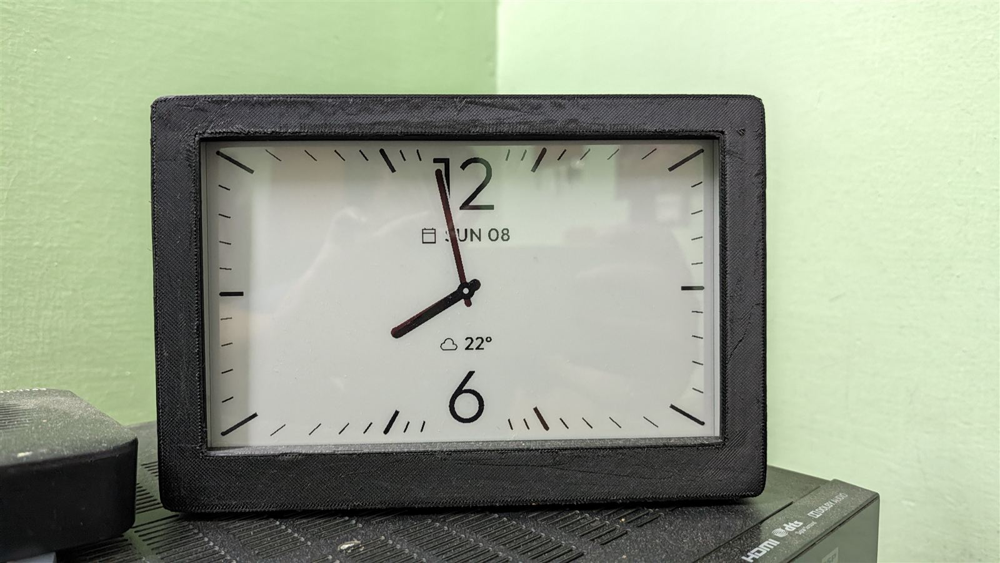
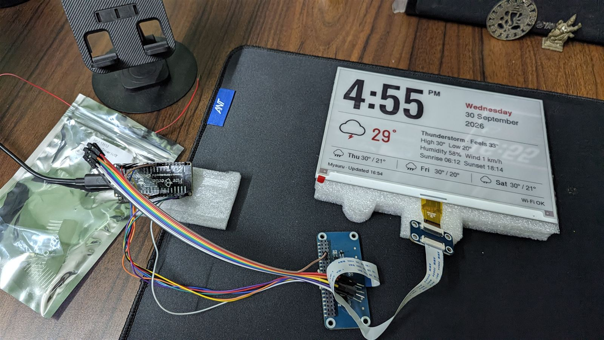

# E-Ink Desk Clock

Firmware written by directing AI coding agents (Claude Code); hardware chosen, wired
and assembled by [Shashi Kumar S](https://shashikumars.github.io).

A big clock, the date, current weather and a 3-day forecast on a Waveshare 7.5" (B)
black/white/red e-paper, driven by a FireBeetle 2 ESP32-S3 (DFR1145). Weather comes from
Open-Meteo (free, no API key).

## How the screen updates

| When | Refresh | What changes |
|---|---|---|
| Every minute | Fast black/white partial, ~1.5 s, no flashing | Clock digits only |
| Every 30 min (setting), a new day, or after saving settings | Full colour, 16–26 s, flashes | Everything, including red |

Two layouts from the Claude Design handoff, picked on the settings page:

- **Clock and weather** (design 1b): date line, big clock and current weather on the left; next
  days, sunrise/sunset and status on the right. Red marks the current temperature.
- **Clock and date only** (design 2): weekday and AM/PM on top, a huge centred clock, date and
  year below. Red marks the weekday. Weather is still fetched so Auto theme knows sunset.

A third clock style, **Analog, full screen**, replaces either layout with a landscape watch
face: ticks around the screen edges, a thin 12 and 6, the date under the 12 and the weather above
the 6. It is all black, and the every-minute refresh covers the whole screen.

Each has a **Light**, **Dark** or **Auto** (dark from sunset to sunrise) theme. Red is only used
for things that change slowly, because the every-minute refresh can't draw red.

## Plugins

The dashboard at http://eink-clock.local shows what's on the display and lets you pick a plugin:

| Plugin | What it shows | Code |
|---|---|---|
| Clock | The two layouts above, digital or analog, or the full-screen analog face | `src/ui.cpp` |
| Photo | A photo uploaded from a phone or PC (processed in the browser) | `src/webui_photo.h`, `src/photo_store.cpp` |
| Solar system | Real-time Earth, Moon and Sun, or all eight planets | `src/plugin_solar.cpp`, `src/astro.cpp` |

To add a plugin: add a `SHOW_` value in `src/settings.h`, draw it with the helpers in
`src/ui_draw.h`, call it from `render()` in `src/ui.cpp` (and say how often it refreshes in
`uiShowClock()`), and add a card for it in `sendPage()` in `src/webui.cpp`.

## Wiring

| HAT pin | FireBeetle label | GPIO |
|---|---|---|
| VCC  | 3V3  | – |
| GND  | GND  | – |
| DIN  | MOSI | 15 |
| CLK  | SCK  | 17 |
| CS   | SS   | 10 |
| DC   | D11  | 13 |
| RST  | D12  | 12 |
| BUSY | D10  | 14 |
| PWR  | D7   | 9 (only if your HAT has this pin) |

HAT switches: **Display Config = B**, **Interface Config = 0** (4-line SPI).

The HAT (Rev2.3) needs **PWR**: its 8-wire cable has no PWR wire, so PWR goes through the 40-pin
socket either way.

### Wiring through the 40-pin socket (used in the case)

The white 9-pin plug doesn't fit inside the printed case, so the build uses male-to-female
jumpers into the HAT's 40-pin (Raspberry Pi) socket. Rows count from the **Interface Config**
end; the **edge** column is along the board's edge, the **middle** column is toward the chips.

| Signal | Socket pin | Row | Column | FireBeetle |
|---|---|---|---|---|
| VCC  | 2 (or 4) | 1 (or 2) | edge   | 3V3 |
| GND  | 9  | 5  | middle | GND |
| RST  | 11 | 6  | middle | D12 / IO12 |
| PWR  | 12 | 6  | edge   | D7 / IO9 |
| BUSY | 18 | 9  | edge   | D10 / IO14 |
| DIN  | 19 | 10 | middle | MOSI / IO15 |
| DC   | 22 | 11 | edge   | D11 / IO13 |
| CLK  | 23 | 12 | middle | SCK / IO17 |
| CS   | 24 | 12 | edge   | SS / IO10 |

Two things that aren't obvious:
- **Power goes on pin 2 or 4** (the Raspberry Pi's 5 V pins), not pin 1 or 17. On this HAT the
  Pi's 3.3 V pins aren't connected to anything; the 5 V pins are the same circuit as the white
  connector's VCC, and 3.3 V from the FireBeetle on them works. Never feed the FireBeetle's VCC
  (5 V) there.
- **Keep everything off the FireBeetle's IO0/D9 pin** (next to IO9/D7): pulling it low at
  start-up puts the board into download mode instead of running the clock.

To check a wiring point, connect a jumper to **A1 (IO5)** and open **http://eink-clock.local/probe**:
it shows live whether the other end touches power, GND or nothing. The boot log's
"Display check" lines say whether BUSY is connected and the panel answers.

Reserved for later (leave empty for now): SDA/SCL (GPIO 1/2) for an SHT31 sensor, A0 (GPIO 4)
for the battery divider.

## First upload (USB)

1. Open this folder in VS Code (File → Open Folder).
   PlatformIO downloads the ESP32 tools and libraries the first time (a few minutes).
2. Plug the FireBeetle into the PC with USB-C.
3. PlatformIO sidebar → **usb** → **Upload**.
   If upload fails: hold **BOOT**, tap **RST**, release **BOOT**, then upload again.
4. **usb** → **Monitor** shows the log.

## First run

1. The screen shows **Wi-Fi setup** (the first colour refresh takes up to ~26 s). On your phone,
   join the `EInk-Clock-Setup` network, pick your home Wi-Fi and enter the password.
2. Open **http://eink-clock.local** (or the IP shown in the Monitor log) on your PC or phone.
3. Enter your city, pick 12/24-hour and units, and click **Save**.

## Later updates over Wi-Fi

PlatformIO sidebar → **ota** → **Upload**. No cable needed. The PC and clock must be on the same
Wi-Fi.

## Where things are

| File | What it does |
|---|---|
| `src/config.h`      | Pins and timing |
| `src/ui.cpp`        | Screen layout: positions, fonts, colours, the fast-refresh clock area |
| `src/ui_fonts.h`    | Bitmap fonts (generated, see below) |
| `src/ui_icons.h`    | Weather icons (generated, see below) |
| `src/epd.cpp`       | Display driver (Waveshare's official command sequences) |
| `src/photo/`        | Photo test program (PlatformIO env `photo`) |
| `src/weather.cpp`   | Open-Meteo requests |
| `src/webui.cpp`     | Settings web page and `/api/status` JSON |
| `src/sensors.cpp`   | Indoor sensor and battery (v2 upgrade) |
| `src/settings.cpp`  | Saved settings |

## Fonts, icons, frame and photos

The screen uses Barlow Condensed, Barlow, IBM Plex Mono and Outfit (SIL Open Font License) and Material
Symbols Sharp icons (Apache 2.0), converted to 1-bit bitmaps. The tools need
[Node.js](https://nodejs.org). In the `tools` folder run `npm install` once, then:

| Command | Makes |
|---|---|
| `node make-ui-assets.cjs` | `src/ui_fonts.h` and `src/ui_icons.h` (edit the size lists at the top to change them) |
| `node make-frame.cjs` | The 3D-printed case in `frame/` |
| `node make-photo.cjs photo.jpg` | A photo for the `photo` env, plus previews in `photo/` |

## Case

`frame/frame_front.stl` and `frame/frame_back.stl`, printed in matte black. The front takes four
M3 × 6 heat-set inserts (4.2 mm holes); join the halves with 4 × M3 × 12 screws from the back.
The HAT mounts connectors-down on its four posts with M2.5 × 6 self-tapping screws. The USB-C
extension cable leaves through the hole at the lower left of the back.

## Upgrading later

- **Indoor sensor:** connect an SHT31 to 3V3, GND, SDA, SCL. It's detected at boot and shown at
  the top right automatically.
- **Battery:** plug a LiPo into the PH2.0 connector (check polarity). Add two 220 kΩ resistors in
  series from the **VCC** pin to GND with the midpoint on A0, then tick **Battery monitor
  installed** on the settings page. The next firmware step uses the same reading to detect a
  power cut and switch to a black/white, deep-sleep battery mode.
